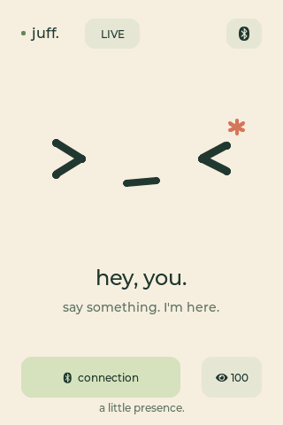
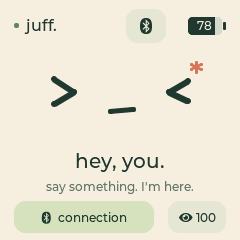
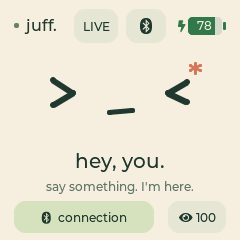
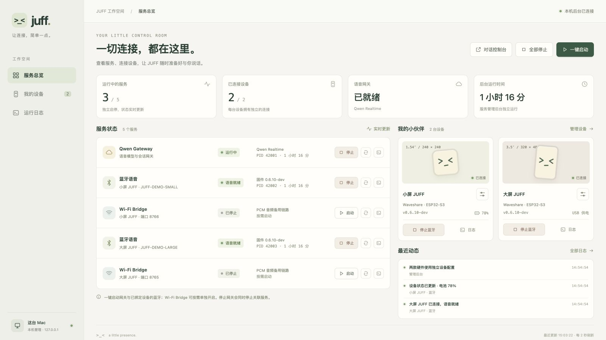

# JUFF：ESP32-S3 × Qwen 实时语音伴侣

[English](README.en.md) · [架构](docs/architecture.md) · [固件说明](firmware/README.md) · [参与贡献](CONTRIBUTING.md)

| 3.5 英寸 · 320×480 | 1.54 英寸 · 240×240 |
| :---: | :---: |
|  |  |

*由 `0.7.0-dev` 固件 UI 离屏渲染，按两款屏幕的原生分辨率展示；小屏电量为示例百分比。*

JUFF 把 Waveshare **ESP32-S3-Touch-LCD-3.5 / 1.54** 变成一个带屏幕、触摸、
麦克风和扬声器的实时语音终端。默认链路是加密 Bluetooth LE：
ESP32 将麦克风音频送到 Mac，Mac 上的
`qwen-audio-agent` 连接 DashScope，再把流式语音回答送回设备播放。

Wi-Fi/WebSocket 是可选的备用链路。DashScope API Key 始终留在 Mac，
不会写入 ESP32。

> 项目目前处于硬件原型阶段，请按实际板型选择固件配置。它不是阿里云、
> Qwen 或 Waveshare 的官方项目。

## 工作方式

```text
ESP32 麦克风
    │  16 kHz G.711 μ-law
    ▼
加密 BLE ──► Mac JuffBLE ──► Qwen Audio Agent ──► DashScope
    ▲                                  │
    │       24 kHz G.711 μ-law         │
    └──────── ESP32 扬声器 ◄───────────┘
```

仓库默认配置下，两款硬件均关闭本地 AEC/VAD 语音打断，采用半双工：播放
回答时暂停上传麦克风，使用屏幕或 GPIO 0 按钮手动停止。两款硬件均可按
[固件说明](firmware/README.md) 显式开启实验性语音打断；声学验证尚不完整。
固件包 `manifest.json` 中的 `features.voice_interrupt` 和 `aec_reference`
记录实际开关与该硬件的参考通路。

[语音打断验证记录](docs/voice-interruption-validation.md) 保留历次失败与修复后的
受控实测结果：`0.7.0-dev` 大小屏长语音播放和八次打断后的固定短句完整识别
均通过。真人语音及不同环境下的声学可靠性仍需更广泛验收；低带宽链路的
播放限制也记录在同一文档中。
当前两款实机均已安装 `0.7.0-dev`，完成蓝牙、音频自检及合成唤醒回应检查。
大屏启动日志确认 LCD 首帧传输与触摸初始化；驱动日志不等同于目视显示验收。
旧版黑屏排查与当前验证边界见 [大屏 AEC 记录](docs/waveshare-lcd-3.5-aec-feasibility.md)，
最新安装记录见 [语音唤醒说明](docs/voice-wake.md)。
完整设计见 [docs/architecture.md](docs/architecture.md)。

`0.6.8-dev` 加入设备端约 4 秒的音频缓冲和按剩余空间发送的 BLE 流控。
先预存约 300 ms 再播放，合成超前的音频在 Mac 排队；打断时清掉两端待播内容。
两款硬件分别构建，Mac 也兼容尚未升级的旧固件。
`0.6.10-dev` 修复并发流控通知乱序、Wi-Fi 缓冲满时丢音频和打断后麦克风
半帧残留；麦克风边界修复需要同时更新设备固件和 Mac BLE 程序。

## 支持的硬件

| 板型 | 显示与触摸 | 音频 |
| --- | --- | --- |
| ESP32-S3-Touch-LCD-3.5 | ST7796，320×480，FT6336 | ES8311 输入／输出，TCA9554 控制功放 |
| ESP32-S3-Touch-LCD-1.54 | ST7789，240×240，CST816 | ES7210 麦克风输入，ES8311 输出，GPIO 7 控制功放 |

两款均使用 ESP32-S3、16 MB Flash、8 MB Octal PSRAM。1.54 英寸版提供紧凑
首页和配对页，保留语音、打断、亮度控制与蓝牙配对功能。
小屏 PWR 长按约 3 秒，看到关机提示后松手即可关机，再按 PWR 开机；
插着 USB 时进入深度睡眠，充电仍可继续。BOOT 仍用于手动打断。
小屏右上角显示电池百分比和填充，充电时保留数字并显示绿色闪电；
20% 及以下使用红色，读取失败显示 `--`。充电与拔线不会隐藏百分比。
数字仍为电压估算，尚未针对所装电池标定剩余容量。



*小屏充电状态示例；大屏不显示未支持的电池读数。*

外观相似的 Touch-AMOLED-1.8 使用不同的屏幕和引脚，不能直接刷入本固件。

## 语音唤醒

点击设备顶部 **LIVE / WAKE**，在原有直接对话和语音唤醒之间切换，重启后记住
选择。WAKE 模式先说 **“Hi，喵喵”或“喵喵同学”**，听到 **“我在”** 后开始提问；这句提示语
保存在 Mac 本地，在语音通道就绪后播放。唤醒后可连续交流，连续 **3 分钟**没有
对话会结束会话，需再次说唤醒词。待唤醒时只在设备本地检测，不上传环境音频。
默认保留 LIVE 直接对话，两种模式均保留已配置的语音打断功能。

大小屏操作图、更新方法和验证范围见 [语音唤醒说明](docs/voice-wake.md)。
升级需同时更新主机服务、Mac BLE 程序与对应板型的固件，并刷入包内模型镜像。

## WebUI 管理控制台

运行 `make admin`，在 Mac 上打开 <http://127.0.0.1:3210/>，即可统一查看和
管理各项服务。控制台采用桌面宽屏布局，服务列表与设备信息左右并排；沿用
设备的柔和配色和抽象表情，大小屏分别保留自己的配置。

同一 Qwen 本机用户同一时刻使用一个语音通道，多台设备服务可以保持连接。
占用者停止或结束唤醒会话后，仍在等待的设备会自动申请空闲通道，无需手动
重连；已经超时回到 WAKE 待唤醒状态的设备仍需再次唤醒。详见后台说明。



*1600×900（16:9）桌面宽屏截图；蓝牙名称、进程编号、在线状态、电量和日志均为演示数据，不代表实物测试结果。*

| 页面 | 可以做什么 |
| --- | --- |
| 服务总览 | 查看网关与各设备连接服务的状态、模型、进程和运行时间；独立启停或重启 |
| 我的设备 | 分别配置大小屏的蓝牙名称、端口和会话；连接后查看固件、小屏电量和音频指标 |
| 运行日志 | 按服务和关键词筛选最近的连接、启停与错误记录 |

控制台启动后，语音服务保持停止，点击「一键启动」才开启网关与已绑定设备的
蓝牙连接。Wi-Fi Bridge 可单独开启；停止或重启网关会处理其管理的关联服务。
[完整界面导览与宽屏预览](docs/service-manager.md#界面导览) 包含设备页截图和配置说明。

## 已刷好固件的设备：新 Mac 五分钟启动

### 准备

- 一台 Mac，以及可用的蓝牙
- Xcode Command Line Tools（提供 Swift 编译器）
- Node.js `22.22.2+`、`24.15.0+` 或 `26+`；推荐读取项目
  [`.nvmrc`](.nvmrc) 的版本
- DashScope API Key

首次安装 Xcode Command Line Tools：

```bash
xcode-select --install
```

### 1. 克隆并初始化

```bash
git clone https://github.com/daniel-weih/esp32-juff.git juff
cd juff
./scripts/bootstrap_macos.sh
```

初始化脚本会：

1. 用 `npm ci` 安装锁定版本的依赖；
2. 创建权限为私有的 `host/.env` 和随机设备令牌；
3. 编译并签名原生 JuffBLE companion；
4. 以隐藏输入方式保存 DashScope Key；
5. 在尚无助手画像时，默认创建“喵喵”设定，保留已有自定义画像。

它不会烧录 ESP32，也不会覆盖已有的本地配置。

### 2. 配对 ESP32

1. 在 JUFF 首页轻触右上角蓝牙胶囊。
2. 选择 **PAIR A NEW MAC**，设备进入 120 秒可发现窗口。
3. 在 Mac 的配对弹窗中输入设备屏幕显示的 6 位码。
4. JUFF 显示 **New Mac is ready** 后即完成。

ESP32 最多保存两台 Mac 的 bonding 信息，但同一时刻只有一台 Mac 使用
语音链路。

### 3. 启动

推荐先打开 JUFF 服务管理后台：

```bash
make admin
```

访问 <http://127.0.0.1:3210/>，在「我的设备」中填写各设备屏幕上的蓝牙名称，
再点击「一键启动」或单独启动服务。后台本身不会自动开启麦克风或语音会话。

- 分别查看与启停 Qwen Gateway、各设备的蓝牙语音、Wi-Fi Bridge；
- 查看连接状态、固件版本、小屏电量、音频传输指标和最近运行日志；
- 添加、修改或移除设备配置，每台设备使用独立的端口和会话；
- 在「助手设定」编辑默认昵称、性格和说话方式，使用喵喵模板与两个新唤醒称呼保持一致；保存后可重连运行中的设备应用，大小屏共用；
- 一键启动网关及已绑定设备的蓝牙，Wi-Fi Bridge 按需单独启动；
- 停止网关时先停止关联服务；重启网关后恢复先前运行的关联服务。

设备绑定保存在仅本机使用的 `host/.local/devices.json`，不会进入 Git。
后台只监听本机地址，外部终端启动的网关或 Bridge 只显示状态，不会被接管或停止。
停止语音服务后管理页面仍可使用；在后台所在终端按 `Ctrl-C` 会关闭后台和它启动的服务。
参见 [管理后台说明](docs/service-manager.md)。

也可以继续使用原有命令，直接开启语音：

```bash
make start
```

随后打开 <http://127.0.0.1:3101/> 查看 Qwen Audio Agent WebUI。
所有 Mac 服务都在当前终端前台运行，按 `Ctrl-C` 会一起停止。

遇到问题时先运行：

```bash
make doctor
```

## 从空白开发板开始

ESP-IDF 只在构建或烧录固件时需要，不是日常语音使用的依赖。

```bash
make firmware-setup
make firmware-build-35     # 3.5 英寸版：构建并打包
make firmware-build-154    # 1.54 英寸版：构建并打包
# 或一次生成两个版本
make firmware-build-all
```

两种硬件分别维护配置，公共语音功能共用代码。固件包按硬件和软件版本命名：

| 硬件版本 | 板型 ID | 固件包（位于 `dist/firmware/<软件版本>/`） |
| --- | --- | --- |
| 3.5 英寸 | `waveshare-lcd-3.5` | `juff-waveshare-lcd-3.5-v<软件版本>.zip` |
| 1.54 英寸 | `waveshare-lcd-1.54` | `juff-waveshare-lcd-1.54-v<软件版本>.zip` |

烧录时必须明确指定板型和串口，例如烧录 1.54 英寸板：

```bash
make firmware-flash JUFF_BOARD=waveshare-lcd-1.54 PORT=/dev/cu.usbmodemXXXX
```

3.5 英寸板使用 `JUFF_BOARD=waveshare-lcd-3.5`。构建目录分别为
`firmware/build/<板型>/`，不复用另一板型的 GPIO 或本地 `firmware/sdkconfig`。
通用命令 `make firmware-build` 也必须指定 `JUFF_BOARD`；未指定时停止执行。
USB 的通用 ESP32 标识无法区分这两块板，因此烧录入口不自动选择板型或串口。
每个固件包包含烧录说明、板型清单和 SHA-256 校验值；CI 也分别构建并保存两版。

请将 `/dev/cu.usbmodemXXXX` 换成当前 Mac 上实际出现的串口。首次刷机前
建议自行备份原厂 Flash；备份可能包含设备数据且可能受厂商许可限制，
因此 `backups/` 永远不会进入本仓库。

ESP-IDF 项目固定使用 5.5.x。更多硬件、自检和引脚资料见
[`firmware/README.md`](firmware/README.md)。

## 可选 Wi-Fi 备用链路

纯 BLE 语音不需要 Wi-Fi。默认 Bridge 只监听 `127.0.0.1`，不会暴露到
局域网。需要启用 Wi-Fi 时：

1. 将 `host/.env` 中 `JUFF_BRIDGE_HOST` 改为 `0.0.0.0`；
2. 保留初始化脚本生成的随机 `JUFF_DEVICE_TOKEN`；
3. 运行 `python3 scripts/provision_ble.py`，通过已加密 BLE 写入 Wi-Fi
   和 Bridge 配置。

也可以通过 USB 配置；该方式额外需要 `pyserial`：

```bash
python3 -m venv .venv
.venv/bin/pip install pyserial
.venv/bin/python scripts/provision_wifi.py
```

## 常用命令

多台 JUFF 在附近时，可指定要使用的设备，例如
`JUFF_BLE_DEVICE=JUFF-XXXX make start`。将 `JUFF-XXXX` 替换为板载蓝牙连接页
显示的设备名称。

| 命令 | 用途 |
| --- | --- |
| `make setup` | 初始化一台新 Mac |
| `make doctor` | 检查 Node、Swift、配置和设备 |
| `make admin` | 启动本机 JUFF 服务管理后台（3210 端口），按需启停各项服务 |
| `make start` | 启动 Gateway、WebUI、BLE companion 和备用 Bridge |
| `make test` | 仓库检查、固件工具与 Node 测试、JuffBLE 自检 |
| `make firmware-build-35` / `make firmware-build-154` | 构建并打包对应硬件版本 |
| `make firmware-build-all` | 构建并打包两个硬件版本 |
| `make firmware-build JUFF_BOARD=<板型>` | 仅构建指定硬件版本 |
| `make firmware-flash JUFF_BOARD=<板型> PORT=<串口>` | 烧录指定设备并打开串口监视器 |

## 仓库结构

```text
firmware/   ESP-IDF 固件、显示、音频、BLE 和 Wi-Fi 客户端
host/       Node.js 主控、Qwen Gateway 连接和 WebSocket Bridge
macos/      原生 CoreBluetooth companion
scripts/    初始化、诊断、构建、配网和仓库检查
docs/       架构与协议文档
.github/    CI、依赖更新和 Issue/PR 模板
```

## 密钥与隐私

- DashScope Key 默认写在 `~/.config/qwaudio/config.env`（或
  `$XDG_CONFIG_HOME/qwaudio/config.env`），不在仓库内。
- `host/.env`、`firmware/sdkconfig`、NVS/Flash 备份和全部构建输出均被忽略。
- Gateway/WebUI 默认只监听本机。
- 将 Bridge 暴露到局域网前必须使用随机设备令牌。
- 不要把真实 API Key、Wi-Fi 密码、配对码或日志中的凭据提交到 Issue。

发布前可运行 `./scripts/check_repository.sh` 做最小敏感信息与可移植性检查。
安全问题请按 [SECURITY.md](SECURITY.md) 私下报告。

## 开发与贡献

```bash
./scripts/check_repository.sh
cd host && npm test
./scripts/build_macos_ble.sh
./macos/build/JuffBLE.app/Contents/MacOS/JuffBLE --self-test
```

提交 Pull Request 前请阅读 [CONTRIBUTING.md](CONTRIBUTING.md) 和
[CHANGELOG.md](CHANGELOG.md)。

## 许可证

项目代码与文档采用 [Apache License 2.0](LICENSE)。第三方组件按各自许可证
发布；使用 DashScope 需要用户自己的阿里云账户，并受其服务条款和计费规则
约束。
