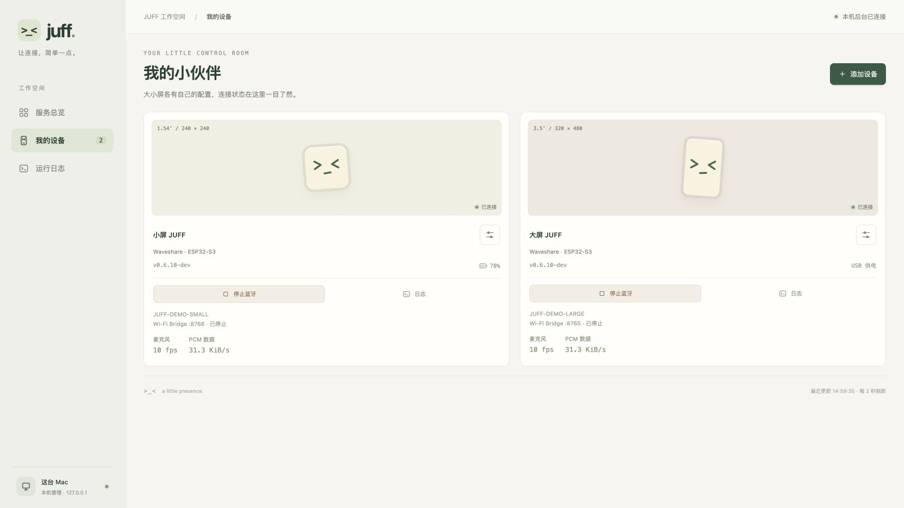

# JUFF 服务管理后台

运行 `make admin`，访问 <http://127.0.0.1:3210/>。后台独立于语音服务运行，
启动页面不会自动连接设备、打开麦克风上传或建立 Qwen 语音会话。
可通过 `host/.env` 中的 `JUFF_ADMIN_PORT` 调整端口；监听地址固定为 `127.0.0.1`。

## 界面导览


以上及下方图片为真实 WebUI 的 1600×900（16:9）桌面宽屏截图，使用只读演示数据。
`JUFF-DEMO-SMALL`、`JUFF-DEMO-LARGE`、进程编号、在线状态、固件、电量和日志
均为示例，不包含真实设备标识、凭据或对话，也不代表实体硬件验收。

| 页面 | 界面与操作 |
| --- | --- |
| 服务总览 | 顶部显示运行服务数、连接设备数、网关和后台运行时间。宽屏左侧为服务列表，右侧并排展示大小屏设备卡片及最近动态；支持独立启停、重启和日志入口，网关就绪后可打开 Qwen 对话控制台。 |
| 我的设备 | 用方形与竖屏表情卡片区分两种硬件。设置按钮可修改名称、硬件型号、蓝牙绑定、Bridge 端口和会话。连接后显示固件、电量及麦克风帧率和主机上行 PCM 数据量；后者不是 BLE 无线链路速率。 |
| 运行日志 | 按服务下拉筛选，或搜索日志文字；页面自动刷新，显示最近 600 条运行记录。点击设备或服务旁的日志按钮可直接定位。 |



*设备卡片横向排列并利用桌面宽度；后台仍仅在运行它的 Mac 本机开放。*

## 服务与设备

后台默认列出 1.54 英寸和 3.5 英寸两个设备配置，可增加到八台。
打开「我的设备」，填写蓝牙连接页显示的 `JUFF-XXXX` 名称。
同一蓝牙名称只能绑定一个配置，Bridge 端口与会话编号也必须各不相同。
只用 Wi-Fi 时可留空蓝牙名称。这里的硬件选择用于组织连接，不会烧录固件。

| 服务 | 查看与操作 |
| --- | --- |
| Qwen Gateway | 查看健康状态、模型、PID 和运行时间；启动、停止、重启 |
| 每台设备的蓝牙语音 | 查看搜索、连接、语音就绪状态和固件、电量、音频指标；独立启停 |
| 每台设备的 Wi-Fi Bridge | 查看监听与设备连接状态；按配置的端口独立启停 |

「一键启动」会启动网关和已绑定设备的蓝牙。Wi-Fi Bridge 按需单独开启，
监听范围沿用 `JUFF_BRIDGE_HOST`；设备上的 Bridge 地址需与这里的端口相符。
固件版本与电量在收到设备状态后显示，离线保留的电量明确标记为上次读数。
大屏不显示其未支持的电池数据。麦克风指标在没有新数据时停止显示。

停止一台设备不会停止其他设备或共享网关。停止网关会先停止它管理的全部
连接服务；重启网关会恢复此前运行的连接服务。外部终端启动的网关和 Bridge
只显示状态，需在原终端停止。请将同一设备的蓝牙连接交给一个启动入口管理。

运行日志只在内存中保留最近 600 条，可按服务与文本筛选；后台重启后清空。
原始麦克风载荷与主机输出的对话文本不进入管理日志，已知凭据会脱敏。
错误仍可能涉及运行环境，分享日志前应查看其内容。

## 本机配置

设备配置写入 `host/.local/devices.json`，使用原子替换和 `0600` 文件权限。
整个目录由 Git 忽略，仓库检查也会拒绝强制加入的本地状态文件。
后台不返回 `.env` 内容或设备令牌。DashScope Key 继续由 Qwen 的本机配置保存。
修改或移除设备配置前需停止该设备的蓝牙和 Bridge 服务。

停止语音服务不会关闭页面。在启动后台的终端按 `Ctrl-C`，会关闭后台及其
启动的服务；进程清理只作用于它创建的进程组，不按进程名称批量结束其他程序。

## 管理接口

静态页面与接口共享同一本机端口，不开放 CORS。浏览器请求必须使用正确的
Host；写请求还需同源 Origin、JSON Content-Type 和当前实例的 `X-Juff-CSRF`
请求头。令牌由 `GET /api/state` 提供，后台重启后刷新页面重新获取。
这些措施防止外部网站通过浏览器控制本机服务，不是多用户或远程登录系统。

| 方法与路径 | 用途 |
| --- | --- |
| `GET /api/state` | 服务、设备、环境准备状态与最近日志 |
| `GET /api/logs?service=<id>&after=<序号>` | 按服务或序号读取运行日志 |
| `POST /api/services/<id>/start` | 启动服务及必要网关 |
| `POST /api/services/<id>/stop` | 停止拥有的服务；`all` 停止全部拥有的服务 |
| `POST /api/services/<id>/restart` | 重启服务；网关会恢复先前的关联服务 |
| `POST /api/devices` | 添加设备配置 |
| `PUT /api/devices/<id>` | 更新已停止设备的配置 |
| `DELETE /api/devices/<id>` | 移除已停止设备的配置 |

服务 ID 为 `gateway`、`<设备编号>-ble` 和 `<设备编号>-bridge`。
命令仅映射到项目内固定的可执行程序及参数，不提供任意 shell 执行接口。

## 验证

`cd host && npm test` 包含配置校验、跨站请求拦截、受控生命周期、依赖重启、
日志脱敏与真实进程组退出测试。测试使用本机假网关及合成事件，不需要实体
设备、麦克风或云端账号。前端为原生 HTML/CSS/JavaScript，无额外构建依赖。

更新文档截图时，可从仓库根目录运行：

```bash
node scripts/preview_service_manager.mjs
```

打开 <http://127.0.0.1:3211/>，在 1600×900 的桌面窗口中截取总览和设备页。
该预览复用正式页面资源，
仅提供合成状态，拒绝服务操作和配置写入，也不读取 `.env` 或本机设备绑定。
按 `Ctrl-C` 关闭；日常管理仍使用 `make admin` 的 3210 端口。
