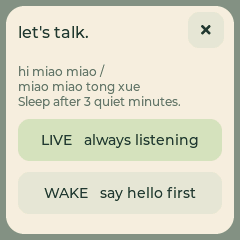
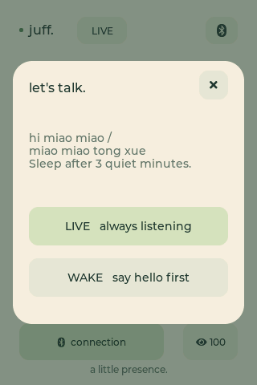
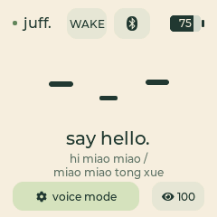
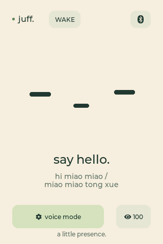

# 语音唤醒与对话模式

从 `0.7.0-dev` 起，两款设备均提供本地语音唤醒。默认仍是直接对话；点击设备
顶部的 **LIVE / WAKE** 按钮选择模式，设置保存在各自设备的 NVS 中，重启后保留。

| 模式 | 使用方法 | 空闲时行为 |
| --- | --- | --- |
| LIVE · 直接对话 | 连接 Mac 服务后直接说话 | 保持原有连续对话，不启用 3 分钟超时 |
| WAKE · 语音唤醒 | 先说“Hi，喵喵”或“喵喵同学”，听到“我在”后再说问题 | 连续 3 分钟没有对话，结束语音会话并等待再次唤醒 |

唤醒后，Mac 会在语音通道就绪时播放一句本地保存的“我在”，不必等待云端
临时合成提示语。每次唤醒只回应一次，重复握手或同一会话的云端重连不会重复
问候；连接失败时也不会用提示音表示已经准备好。LIVE 模式连接后保持原来的
直接对话行为。提示音经过现有播放缓冲和打断链路，大小屏及 BLE／Wi-Fi 共用。

从 `0.7.1-dev` 起，同时支持 **“Hi，喵喵”**（`hi miao miao`）和
**“喵喵同学”**（`miao miao tong xue`），任意一句都能唤醒，无需切换唤醒词。
原来的“你好小智”不再作为唤醒词。后台提供对应的喵喵昵称模板；已有自定义
助手设定不会被固件升级自动覆盖，可在后台按需修改。

两个独立的 WakeNet9 模型来自固定版本 ESP-SR 2.5.3：
`wn9_himiaomiao_tts` 和 `wn9_miaomiaotongxue_tts`。它们同时接收同一段
本地麦克风音频；任意一个识别成功，只创建一次对话并停止两个模型的检测。
会话结束后两个模型一同重新就绪。缺少任意一个模型或初始化失败，都显示
唤醒不可用，避免界面声称支持两句但实际只支持一句。
模型定义实际识别的发音，修改界面文字不能任意更换唤醒词。详见
[Espressif 唤醒词列表](https://github.com/espressif/esp-sr/blob/master/wakeword_list.md)。

## 设备端界面

| 1.54 英寸 · 240×240 | 3.5 英寸 · 320×480 |
| --- | --- |
|  |  |
|  |  |

图片由实际 LVGL 界面代码渲染，电量使用演示数据。待唤醒时显示闭眼表情和
`say hello.`；唤醒后建立会话，准备好后回到现有听说表情。底部 `voice mode`
也可打开模式选择。点击表情或 BOOT 仍用于停止当前回答，不会绕过语音唤醒。
Mac 管理后台可查看设备当前是直接对话、等待唤醒还是唤醒后的对话状态。

## 3 分钟的含义

- 从唤醒或最近一次对话活动开始计时；云端重连、重新就绪不会续期。
- 用户的有效语音、服务端的听说状态和设备播放活动会更新计时；持续播放期间
  不会因为计时到期而截断回答，播放结束后重新计时。
- 静音 PCM、BLE 状态轮询、心跳、界面动画和重复握手不算对话。
- 超时后停止上传麦克风，清理待播和待发音频，Mac 关闭该设备的云端语音连接。
  本地麦克风只给唤醒检测使用，不把环境声音或唤醒词上传。
- 断线重连、重启或切换进入 WAKE 后均重新等待唤醒。切回 LIVE 会重新建立
  连续对话。显式暂停麦克风和原有语音打断逻辑仍由现有音频链路控制。

这属于结束当前语音会话，不是关机或深度睡眠。检测唤醒词需要麦克风和处理器
保持工作；仍需 Mac 服务在线才能进行问答。会话使用原设备的 session ID，
超时不等同于删除历史记录。

## 更新与构建

1. 更新主机代码并执行 `make ble-build`，重启相应设备的 BLE／Wi-Fi 服务。
2. 分别执行 `make firmware-build-154` 和 `make firmware-build-35`。
3. 对照实物板型安装对应固件包，按包内 `flash_args` 写入全部镜像。

已有构建目录需同步检查各自 `sdkconfig`：
`CONFIG_SPIRAM_MALLOC_ALWAYSINTERNAL=0`，
`CONFIG_SPIRAM_ALLOW_BSS_SEG_EXTERNAL_MEMORY=y`。
新的默认配置不会覆盖已保存的值；旧的内部内存分配设置可能导致启动时内存不足。

`model` 分区仍在 `0x420000`，大小为 2 MiB；现有 NVS、应用和 coredump
位置不变。固件包包含模型镜像、写入位置和校验值，打包时会拒绝缺少匹配模型的
唤醒固件，两个喵喵模型必须同时存在。升级旧版时应用和模型镜像都要更新。
**只刷应用镜像不能安装模型。** `JUFF_WAKE_WORD` 默认开启，独立于
实验性的 `JUFF_VOICE_BARGE_IN`；不需要为了语音唤醒开启语音打断。

模型初始化安排在 LCD DMA、蓝牙和 Wi-Fi 初始化之后，通用内存优先使用
PSRAM，为显示与无线链路保留内部 SRAM。启动时执行静音推理和模型重建检查。
蓝牙音频拼包使用外部 BSS 中的 19.2 KB 缓冲，音频驱动单独管理 DMA 缓冲。
固定版本 ESP-SR 的 WakeNet9 状态清理接口在实机上发生越界崩溃，因此在对话
边界按需销毁并重建模型，避免调用该接口；重复待机检查不会反复重建。
初始化失败会保留 WAKE 的静默状态，
界面提示不可用，可由用户切回 LIVE，不会自动改成持续上传。
新功能需要同版本的主机服务与固件；新版主机继续兼容旧设备固件。

## 双唤醒词验证（0.7.1-dev）

2026-09-07，两款独立固件均已构建并安装。每台设备先核对硬件身份、完整备份
Flash，再只写入应用和模型；原分区布局与 NVS 保留。启动日志均确认 LCD 首帧、
AEC，以及两个 WakeNet9 模型同时就绪。

使用 Mac 本地合成语音，通过设备实际麦克风和已配对 BLE 链路验证：

| 设备 | “Hi，喵喵” | “喵喵同学” | 唤醒后收音／缓存提示音 |
| --- | --- | --- | --- |
| 1.54 英寸 | 2/2 | 2/2 | 四轮全部恢复收音、提示音完整结束，新增欠载／丢音频均为 0 |
| 3.5 英寸 | 2/2 | 2/2 | 四轮全部恢复收音、提示音完整结束，新增欠载／丢音频均为 0 |

每台设备还分别播放一次无关语句和旧词“你好小智”，均未唤醒，待机期间没有
麦克风数据上传。串口记录确认四次命中依次来自两个不同模型。每轮重连后重新
进入待唤醒，验证两个模型能够再次识别。测试使用本地 BLE 程序模拟语音就绪，
播放现有“我在”音频，不调用云端、不保存麦克风录音。

小屏原先保存在 LIVE；为自动测试，临时测试应用只将本次启动的内存模式置为
WAKE，没有写入 NVS。完成后已恢复正式应用，并核对重新构建的应用与原正式包
SHA-256 一致。大屏直接测试正式固件，保留原有 WAKE 选择。

两台正式固件另各完成一次 69.69 秒缓存长语音回放，小屏实际 69.721 秒、
大屏 69.733 秒结束，新增欠载、丢音频和打断事件均为 0，播放后恢复收音。
此前小屏一轮在 3.780 秒收到过打断
事件，未同步采集诊断日志，现场是否有独立声音也未确认；不能据此判定为自打断，
后续通过的回放也不能抹去该事件。另一次大屏启动后立即播放合成唤醒词未命中。

首轮 Mac 输出音量约 6% 时，合成“Hi，喵喵”未命中；小屏收到的语音峰值仅
17–26 RMS／100 ms，静音背景为 11。将同一输出设备临时调至约 26% 后获得上表
结果，测试结束后已恢复原输出音量。八次从外部播放器启动到唤醒事件的时间为 1.793–2.218 秒，包含播放器启动
和蓝牙通知耗时，不是单纯的声学算法延迟。这些是固定合成语音、固定环境的
功能检查，不代表真人、多说话人、远场或长期误唤醒率。

自动测试覆盖两个词独立触发、同时命中只创建一次对话、重置后再次识别、
两个模型收到相同的重采样麦克风、缺少第二模型、帧长不兼容，以及第二模型
创建／重置失败时的清理。固件打包也拒绝只包含一个模型或仅含旧模型的镜像。

## 既有版本验证与实物边界

本节以下为 `0.7.0-dev` 的历史结果，使用当时的“你好小智”模型；不能直接
作为新双唤醒词模型准确率的依据。

自动测试覆盖 179999／180000 ms 边界、语音和播放续期、默认模式不超时、NVS
保存失败、重连、过期事件、模型缺失、单声道／双声道麦克风路由、播放尾音保护、
待唤醒不上传，以及连接尚未完成时关闭会话。主机还覆盖唤醒回应的就绪时机、
每次唤醒只播一次、过期连接隔离、重连和停止期间的取消，以及本地提示音不会
干扰云端回答的播放状态。两款固件分别构建，界面分别渲染。

模型接口测试使用确定性替身，不能证明真实房间里的唤醒准确率、距离和误唤醒率。
1.54 英寸实机已验证屏幕与触摸初始化、模型静音推理与重建、原有配对的蓝牙
重连，以及扬声器／麦克风短音自检，观察期间没有运行时重启；安装保留原有配置。
3.5 英寸实机也已安装对应固件和离线模型，启动日志确认 LCD 首帧传输和触摸
初始化；另已验证原有配对重连、扬声器／麦克风短音自检，以及合成唤醒词
触发后的本地“我在”回应，
该轮回应完整结束且没有新增缓冲断流或丢音频。两台设备安装均保留原有配置。
真人唤醒的准确率、距离和误唤醒率仍待验证。
首帧传输与触摸初始化日志不替代对实体屏幕的目视验收。

小屏另已完成一次合成唤醒词的实物链路测试：Mac 扬声器播放“你好小智”，
设备识别后约 0.69 秒开始播放 0.75 秒的本地“我在”，完整结束，未新增缓冲
断流或丢音频。该结果验证本次唤醒回应链路，不代表不同环境下的唤醒准确率或
固定延迟保证。

故障恢复回归测试将 Mac 实际生成的清理消息送入固件会话控制器，覆盖播放
超时、主机队列溢出和确认异常。当前会话的恢复消息必须携带会话编号；旧会话
消息仍被拒绝。模拟时钟验证恢复后可继续收音，并在唤醒模式下正常执行 3 分钟
空闲超时，同时保留旧固件未使用会话编号时的消息格式。

2026-09-07 已用更新后的 Mac 程序，在 1.54 英寸实机（LIVE）和 3.5 英寸实机
（WAKE）分别注入音频流超时与主机队列溢出。四次均收到设备取消旧播放的确认，
随后麦克风恢复、下一轮语音完整结束，下一轮新增欠载与丢音频均为 0。该测试
使用本地缓存音频，不连接云端；3 分钟边界由上述模拟时钟测试覆盖。
本轮开始时小屏曾报告音频与唤醒未就绪，USB 重启后初始化和上述检查通过；
未取得重启前的失败日志，因此这次结果不能说明此前未就绪状态的原因。

随后增加了重复启动检查：小屏连续 6 次、大屏连续 4 次 USB 硬件重启，逐次
采集启动日志并重新建立已配对的 BLE 连接。十次均完成音频、AEC、WakeNet 和
LCD 首帧初始化，设备状态均确认唤醒与语音打断可用，原有 LIVE／WAKE 模式
保持不变，未出现初始化失败或运行时崩溃。该检查没有复现此前小屏未就绪，
覆盖的是 USB 重启，不等同于电池耗尽后上电或长期稳定性测试。

大屏还通过了真实计时的完整待机检查：正式主机程序连接本地模拟网关，唤醒
回应结束后 180.131 秒进入待唤醒状态，主机关闭该轮语音 WebSocket，BLE 服务
继续运行，随后 2.5 秒没有麦克风数据继续到达或自动重开语音连接。再次播放
合成唤醒词后建立新语音会话，收音恢复，并且只播放一次新的“我在”。测试
不调用云端，不保存麦克风内容，结束后恢复原有服务与 Mac 音量。
